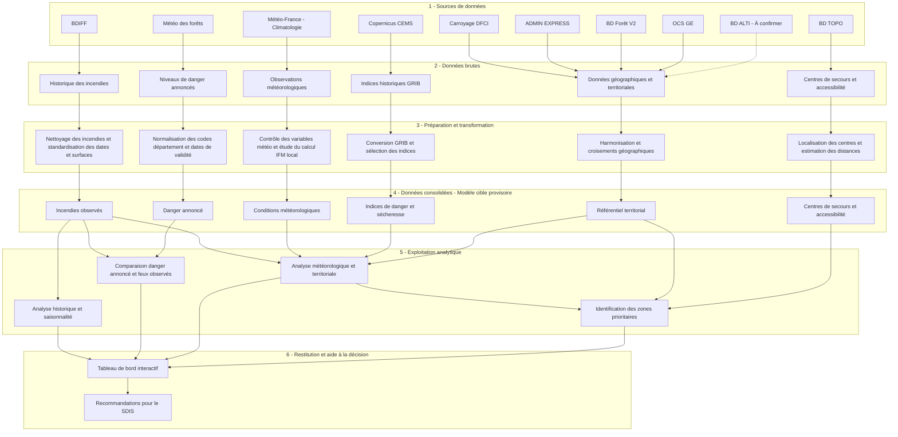

# Data Lineage — V0

**Projet :** Feux de forêt – Centre-Val de Loire  
**Client :** SDIS du Loiret  
**Date :** 20/11/2026  
**Auteur :** Ange Kamguem Mande  
**Statut :** Proposition initiale à valider collectivement

## 1. Objectif

Ce document présente une première représentation de la circulation des données, depuis les différentes sources identifiées jusqu'à leur exploitation dans un outil d'aide à la décision pour le SDIS du Loiret.

Cette version s'appuie sur l'inventaire des sources, les fiches d'identité, la matrice collective questions × sources et les premières explorations réalisées.

Elle sera complétée après la validation du modèle cible et des règles de transformation.

## 2. Vue globale du Data Lineage

## 3. Description des flux par source

| Source | Grain initial | Transformations envisagées | Données cibles | Utilisation |
|---|---|---|---|---|
| BDIFF | Un incendie déclaré | Nettoyage, contrôle des doublons, conversion des surfaces, extraction de la date | Incendies observés | Historique des feux, fréquence, surfaces parcourues, saisonnalité |
| Météo des forêts | Département, date de publication | Calcul des dates de validité J1 et J2, normalisation des niveaux de danger | Danger annoncé | Comparaison entre alertes et incendies observés |
| Météo-France – Climatologie | Station météorologique, jour | Contrôle des valeurs, harmonisation des unités, étude des variables nécessaires au calcul de l'IFM | Conditions météorologiques | Analyse des conditions favorables aux incendies |
| Copernicus CEMS | Date, point de grille géographique | Lecture GRIB, conversion tabulaire, sélection des indices communs aux deux semestres | Indices de danger et sécheresse | Analyse de la sécheresse et des conditions de propagation |
| Carroyage DFCI | Carreau de 2 km × 2 km | Contrôle des identifiants, harmonisation des géométries | Référentiel territorial | Restitution géographique adaptée aux pompiers |
| ADMIN EXPRESS | Entité administrative | Normalisation des codes INSEE, récupération des contours communaux et départementaux | Référentiel territorial | Rapprochement des différentes échelles géographiques |
| BD Forêt V2 | Formation végétale | Harmonisation des catégories et rapprochement spatial, sous réserve de disponibilité des géométries | Caractéristiques forestières | Analyse des types de végétation |
| OCS GE | Objet géographique | Harmonisation des catégories de couverture et d'usage du sol, rapprochement spatial | Occupation du sol | Identification des interfaces forêt-habitat |
| BD TOPO | Objet topographique | Sélection des centres de secours, localisation et estimation des distances | Centres de secours | Analyse de l'accessibilité théorique des zones exposées |
| BD ALTI | Point ou cellule altimétrique selon le fichier retenu | Calcul éventuel de la pente et de l'exposition | Caractéristiques du relief | Analyse complémentaire, sous réserve de validation |

## 4. Rapprochement des données

Les sources ne possèdent pas toutes la même granularité géographique ou temporelle. Plusieurs règles de rapprochement seront donc nécessaires.

| Sources concernées | Clés ou méthode envisagée | Point de vigilance |
|---|---|---|
| BDIFF et ADMIN EXPRESS | Code INSEE | Vérifier le format et l'unicité des codes |
| BDIFF et Météo des forêts | Code département et date de validité | Agréger les incendies au niveau département-jour pour effectuer la comparaison |
| Copernicus et référentiel territorial | Latitude, longitude et géométries | Définir une méthode de rattachement spatial tenant compte de la résolution des données |
| Climatologie et référentiel territorial | Latitude et longitude des stations | Définir une méthode d'affectation ou d'interpolation si nécessaire |
| Carroyage DFCI et ADMIN EXPRESS | Intersection géographique | Un carreau peut intersecter plusieurs communes |
| BD Forêt, OCS GE et DFCI | Intersection géographique | Nécessite les géométries des différentes sources |
| BD TOPO et DFCI | Localisation géographique et calcul de distance | La proximité d'une caserne ne garantit pas la disponibilité des moyens |

La granularité de restitution DFCI ne doit pas être confondue avec la précision réelle des sources. Un incendie connu uniquement à l'échelle communale ne peut pas être attribué avec certitude à un carreau DFCI particulier.

## 5. Premiers contrôles qualité

Les premières transformations devront intégrer des contrôles portant sur :

- La complétude des variables utiles.
- L'unicité des identifiants et des clés métiers.
- La cohérence des dates et des périodes couvertes.
- La validité des coordonnées géographiques.
- L'harmonisation des unités de mesure.
- La cohérence des rapprochements entre sources.
- La traçabilité des valeurs manquantes et des approximations.

### Résultats déjà disponibles pour Copernicus CEMS

L'exploration des deux fichiers GRIB téléchargés a permis d'identifier :

- Une couverture journalière du 1er janvier au 31 décembre 2025.
- 92 points géographiques communs aux deux fichiers.
- 33 580 enregistrements potentiels après consolidation au grain date-point géographique.
- Aucun doublon ni date manquante dans les contrôles réalisés séparément sur les deux fichiers.
- Sept indices communs aux deux semestres, présentant un taux de complétude de 100 %.

Les indices DC et BUI pourront notamment être exploités conformément à l'orientation proposée dans l'inventaire collectif.

## 6. Exploitation métier attendue

| Question analytique | Résultat attendu |
|---|---|
| Q01 – Zones à renforcer | Cartographie et identification des zones prioritaires |
| Q02 – Caractéristiques du territoire | Analyse des caractéristiques forestières, géographiques et environnementales |
| Q04 – Danger annoncé et feux observés | Comparaison des niveaux de danger avec les incendies réels |
| Q05 – Facteurs associés aux départs de feu | Analyse des conditions météorologiques et territoriales |
| Q06 – Seuil de déclenchement | Comparaison de plusieurs seuils théoriques de déclenchement |
| Q07 – Périodes de renforcement | Identification des périodes présentant les enjeux les plus importants |
| Q08 – Comparaison territoriale | Comparaison du Loiret avec les autres départements sur un périmètre de données comparable |

## 7. Limites et décisions à valider

- Les données relatives aux effectifs, aux budgets et aux moyens matériels du SDIS ne sont pas disponibles à ce stade.
- La localisation précise des incendies à l'intérieur des communes n'est pas connue.
- Les données Copernicus ne possèdent pas la même résolution que le carroyage DFCI.
- L'extraction BDIFF actuellement étudiée couvre uniquement l'année 2025 et le Centre-Val de Loire.
- Le calcul d'un IFM local nécessite de vérifier la disponibilité et la qualité des variables nécessaires ainsi que la méthode de calcul.
- Les géométries complètes de certaines sources doivent encore être récupérées ou vérifiées.
- Copernicus Sentinel-2 n'est pas intégré à cette version, conformément à l'orientation de l'inventaire collectif.
- L'intégration de BD ALTI reste à confirmer.

Les recommandations concernant les moyens du SDIS resteront indicatives tant que les ressources réellement disponibles ne seront pas connues.

## 8. Prochaines étapes

Cette version sera actualisée après :

1. La validation collective du périmètre des sources.
2. La définition du modèle cible et de ses granularités.
3. La validation des clés et des règles de rapprochement.
4. La définition détaillée des transformations du pipeline.
5. La validation des indicateurs destinés au tableau de bord.

## 9. Documents de référence

- Commande du SDIS du Loiret.
- Questions analytiques collectives – Ticket #11.
- Inventaire collectif des sources.
- Matrice collective questions × sources – Ticket #13.
- Fiches d'identité des sources.
- Notebook `01_exploration_copernicus.ipynb`.

Ce Data Lineage V0 constitue une première base de travail pour la construction du pipeline et du modèle de données. Il ne représente pas encore un pipeline implémenté ni un modèle définitif.