# Modèle de données cible — V0

- Date : 20/11/2026
- Auteur : Ange Kamguem
- Projet : Feux de forêt — Centre-Val de Loire
- Commanditaire : SDIS du Loiret
- Statut : Proposition à valider collectivement

## 1. Objectif du modèle

Le modèle cible doit permettre de consolider les différentes sources
de données identifiées afin de répondre aux questions analytiques
du projet et d'alimenter le futur tableau de bord décisionnel.

Il doit notamment permettre :

- D'analyser la répartition géographique et temporelle des incendies.
- De comparer les niveaux de danger annoncés aux incendies observés.
- D'identifier les caractéristiques du territoire associées au risque.
- D'identifier les zones et les périodes prioritaires de renforcement.
- De comparer le Loiret aux autres départements.

Cette première version s'appuie sur l'inventaire collectif des sources,
les fiches d'identité, la matrice collective et le Data Lineage V0.

## 2. Choix de modélisation

Nous proposons un modèle en constellation, composé de plusieurs
tables de faits partageant des dimensions communes.

Ce choix s'explique par les différences de granularité entre les
sources :

- BDIFF : un incendie.
- Météo des forêts : un jour par département et échéance de prévision.
- Copernicus CEMS : un jour par point géographique.
- Données climatologiques : un jour par station météorologique.
- Carroyage DFCI : une maille géographique de 2 km × 2 km.

Le modèle s'inscrit dans l'architecture Bronze / Silver / Gold
proposée dans le cadrage technique.

La couche Silver conservera les granularités des sources nettoyées.
La couche Gold contiendra les tables analytiques destinées aux
analyses et à Power BI.

## 3. Périmètre des sources

| Source | Utilisation dans le modèle | Statut |
| --- | --- | --- |
| BDIFF | Historique des incendies | Retenue |
| Météo des forêts | Niveaux de danger annoncés | Retenue |
| Copernicus CEMS | Indices de sécheresse et de danger | Retenue, indices à valider |
| Données climatologiques | Conditions météorologiques locales | Intégration à valider |
| ADMIN EXPRESS | Référentiel administratif | Retenue |
| Carroyage DFCI | Référentiel spatial opérationnel | Retenue |
| BD Forêt V2 | Caractéristiques forestières | Retenue |
| OCS GE | Occupation du sol | Retenue |
| BD TOPO | Localisation des centres de secours | Intégration à valider |
| BD ALTI | Altitude, pente et exposition | Optionnelle |
| Sentinel-2 | Stress hydrique de la végétation | Non retenue |

## 4. Tables de faits proposées

| Table | Granularité | Source | Clé primaire proposée |
| --- | --- | --- | --- |
| fact_incendie | Un incendie déclaré | BDIFF | incendie_id |
| fact_meteo_forets | Une date cible × un département × une échéance | Météo des forêts | date_id + departement_id + echeance |
| fact_danger_copernicus | Une date × un point géographique | Copernicus CEMS | date_id + point_id |
| fact_climatologie | Une date × une station | Données climatologiques | date_id + station_id |
| fact_caracteristiques_maille | Une maille × un millésime de référence | OCS GE, BD Forêt, DFCI | maille_id + millesime_id |

Les clés sont proposées à ce stade. Leur unicité devra être
confirmée lors de la préparation des données.

### 4.1. fact_incendie

Cette table constitue la référence des incendies réellement observés.

| Colonne cible | Type proposé | Rôle | Origine |
| --- | --- | --- | --- |
| incendie_id | STRING | PK | Identifiant construit à partir des champs BDIFF |
| date_id | DATE | FK | Date de première alerte |
| commune_id | STRING | FK | Code INSEE |
| departement_id | STRING | FK | Département |
| surface_parcourue_m2 | DOUBLE | Mesure | Surface parcourue (m2) |
| surface_foret_m2 | DOUBLE | Mesure | Surface forêt (m2) |
| nature_incendie | STRING | Attribut | Nature |
| precision_surface | STRING | Attribut | Précision des surfaces |

L'identifiant incendie_id sera construit après vérification de
l'unicité des identifiants disponibles dans BDIFF.

Les causes manquantes seront conservées comme valeurs inconnues.
Elles ne seront pas remplacées par des causes supposées.

### 4.2. fact_meteo_forets

| Colonne cible | Type proposé | Rôle |
| --- | --- | --- |
| date_id | DATE | PK / FK, date cible |
| departement_id | STRING | PK / FK |
| echeance | STRING | PK |
| date_publication | TIMESTAMP | Traçabilité |
| niveau_danger | INTEGER | Indicateur |

La date cible doit correspondre au jour auquel le niveau de danger
s'applique, et non simplement à la date de publication.

Une échéance commune devra être retenue lors des comparaisons
avec les incendies afin d'éviter les doublons.

### 4.3. fact_danger_copernicus

| Colonne cible | Type proposé | Rôle | Variable source |
| --- | --- | --- | --- |
| date_id | DATE | PK / FK | valid_time |
| point_id | STRING | PK / FK | Identifiant construit |
| fwi | DOUBLE | Indicateur | fwinx |
| ffmc | DOUBLE | Indicateur | ffmcode |
| dmc | DOUBLE | Indicateur | dufmcode |
| dc | DOUBLE | Indicateur | drtcode |
| isi | DOUBLE | Indicateur | infsinx |
| bui | DOUBLE | Indicateur | fbupinx |
| dsr | DOUBLE | Indicateur | fdsrte |

Les deux fichiers téléchargés couvrent l'année 2025.

L'exploration a permis d'observer :

- 16 928 observations dans le premier fichier.
- 16 652 observations dans le second fichier.
- Sept indices communs aux deux fichiers.
- Aucune valeur manquante pour les indices disponibles.

Les sept indices communs seront conservés dans la couche Silver.

L'utilisation analytique de DC et BUI est privilégiée dans
l'inventaire collectif. L'utilisation du FWI comme indicateur
opérationnel local reste à valider.

### 4.4. fact_climatologie

| Colonne cible | Type proposé | Rôle |
| --- | --- | --- |
| date_id | DATE | PK / FK |
| station_id | STRING | PK / FK |
| temperature | DOUBLE | Mesure |
| humidite | DOUBLE | Mesure |
| precipitation | DOUBLE | Mesure |
| vitesse_vent | DOUBLE | Mesure |

Les noms exacts des champs sources, les unités et les horaires
de mesure devront être confirmés.

Le recalcul d'un IFM local reste une piste à étudier.
Il dépend notamment de la disponibilité des variables nécessaires
et de la justification des éventuels proxies.

### 4.5. fact_caracteristiques_maille

Cette table doit permettre de caractériser chaque carré DFCI.

| Colonne cible | Type proposé | Rôle |
| --- | --- | --- |
| maille_id | STRING | PK / FK |
| millesime_id | STRING | PK |
| surface_foret_m2 | DOUBLE | Mesure dérivée |
| proportion_foret | DOUBLE | Mesure dérivée |
| proportion_zone_batie | DOUBLE | Mesure dérivée |
| proportion_zone_agricole | DOUBLE | Mesure dérivée |
| pente_moyenne | DOUBLE | Mesure optionnelle |

Ces mesures seront obtenues à partir des intersections
géographiques entre le carroyage et les sources territoriales.

Les règles de calcul, les millésimes et les catégories retenues
devront être confirmés.

## 5. Tables de dimensions

| Table | Clé primaire proposée | Principaux attributs | Source |
| --- | --- | --- | --- |
| dim_date | date_id | Jour, mois, trimestre, année, saison | Générée |
| dim_departement | departement_id | Code, nom, région | ADMIN EXPRESS |
| dim_commune | commune_id | Code INSEE, nom, géométrie | ADMIN EXPRESS |
| dim_maille_dfci | maille_id | Code DFCI, géométrie | Carroyage DFCI |
| dim_point_copernicus | point_id | Latitude, longitude | Copernicus |
| dim_station_meteo | station_id | Latitude, longitude, nom | Météo-France |
| dim_caserne | caserne_id | Nom, localisation | BD TOPO |

Les référentiels de végétation et d'occupation du sol seront
conservés dans la couche Silver pour produire les caractéristiques
territoriales des mailles.

Leur intégration comme dimensions analytiques supplémentaires
pourra être décidée dans une prochaine version.

## 6. Tables de correspondance géographique

Les sources ne possèdent pas toutes les mêmes identifiants
ni les mêmes granularités géographiques.

Des tables de correspondance sont donc nécessaires.

| Table proposée | Granularité | Utilisation |
| --- | --- | --- |
| bridge_commune_maille | Une commune × une maille DFCI intersectée | Relier les territoires administratifs au carroyage |
| bridge_maille_copernicus | Une maille × un point Copernicus associé | Rattacher les indices météorologiques aux zones d'analyse |
| bridge_maille_station | Une maille × une station associée | Rattacher les observations climatologiques |
| bridge_maille_caserne | Une maille × une caserne associée | Estimer la proximité des centres de secours |

Ces tables devront conserver la méthode de rapprochement utilisée
et, lorsque cela est pertinent, la distance ou le taux de recouvrement.

Les méthodes d'affectation restent à valider.

## 7. Schéma du modèle cible

```mermaid
erDiagram

    DIM_DATE ||--o{ FACT_INCENDIE : date_alerte
    DIM_DATE ||--o{ FACT_METEO_FORETS : date_cible
    DIM_DATE ||--o{ FACT_DANGER_COPERNICUS : date_validite
    DIM_DATE ||--o{ FACT_CLIMATOLOGIE : date_observation

    DIM_DEPARTEMENT ||--o{ FACT_INCENDIE : localisation
    DIM_DEPARTEMENT ||--o{ FACT_METEO_FORETS : localisation

    DIM_COMMUNE ||--o{ FACT_INCENDIE : localisation

    DIM_POINT_COPERNICUS ||--o{ FACT_DANGER_COPERNICUS : mesure
    DIM_STATION_METEO ||--o{ FACT_CLIMATOLOGIE : mesure

    DIM_MAILLE_DFCI ||--o{ FACT_CARACTERISTIQUES_MAILLE : caracterisation

    DIM_COMMUNE ||--o{ BRIDGE_COMMUNE_MAILLE : correspondance
    DIM_MAILLE_DFCI ||--o{ BRIDGE_COMMUNE_MAILLE : correspondance

    DIM_MAILLE_DFCI ||--o{ BRIDGE_MAILLE_COPERNICUS : correspondance
    DIM_POINT_COPERNICUS ||--o{ BRIDGE_MAILLE_COPERNICUS : correspondance

    DIM_MAILLE_DFCI ||--o{ BRIDGE_MAILLE_STATION : correspondance
    DIM_STATION_METEO ||--o{ BRIDGE_MAILLE_STATION : correspondance

    DIM_MAILLE_DFCI ||--o{ BRIDGE_MAILLE_CASERNE : correspondance
    DIM_CASERNE ||--o{ BRIDGE_MAILLE_CASERNE : correspondance
```

Ce schéma représente les relations logiques envisagées.

Les tables de correspondance pourront être utilisées dans le
pipeline pour produire des tables analytiques dédiées, sans
nécessairement activer toutes ces relations dans Power BI.

## 8. Règles de rapprochement

### 8.1. BDIFF et ADMIN EXPRESS

Le rapprochement sera réalisé à partir du code INSEE de la commune.

Les codes seront conservés sous forme de chaînes de caractères
afin de préserver leur format.

### 8.2. BDIFF et Météo des forêts

Les données seront comparées selon :

- La date de première alerte.
- La date cible du niveau de danger.
- Le département.
- Une échéance de prévision homogène.

Les incendies seront agrégés par jour et département avant
le rapprochement analytique.

Les jours sans incendie devront également être conservés pour
évaluer les niveaux de danger annoncés.

### 8.3. BDIFF et carroyage DFCI

Le code INSEE permet de rattacher un incendie à une commune.

Cependant, BDIFF ne permet pas de localiser précisément chaque
départ de feu dans un carré DFCI.

Le rapprochement commune-maille permettra de caractériser
les territoires, mais ne devra pas être présenté comme une
localisation exacte des incendies.

Il faudra éviter de compter plusieurs fois un même incendie
lorsqu'une commune intersecte plusieurs mailles.

### 8.4. Copernicus et carroyage DFCI

Le rapprochement sera réalisé à partir des coordonnées géographiques.

La méthode de rattachement devra être définie et documentée.

La résolution initiale de Copernicus devra être conservée
dans l'interprétation des résultats.

Une association à une maille de 2 km ne signifie pas que
l'indice Copernicus possède une précision de 2 km.

### 8.5. Sources territoriales

Les données OCS GE et BD Forêt seront rapprochées du carroyage
DFCI à partir d'intersections spatiales.

Les surfaces seront calculées dans un système de coordonnées
adapté aux mesures de superficie.

Les différences de nomenclature entre les deux sources
devront être documentées.

## 9. Tables analytiques envisagées pour Power BI

| Table | Granularité | Utilisation principale |
| --- | --- | --- |
| mart_risque_departement_jour | Jour × département | Comparer les niveaux de danger aux incendies observés |
| mart_incendies_commune_jour | Jour × commune | Analyser les incendies dans le temps et l'espace |
| mart_risque_maille_jour | Jour × maille DFCI | Identifier les zones potentiellement exposées |
| mart_synthese_maille | Maille × millésime | Caractéristiques du territoire et proximité des secours |

La construction de mart_risque_maille_jour dépend de la
validation des rapprochements spatiaux et des indices retenus.

Cette table ne représentera pas des départs de feu précisément
localisés à la maille.

## 10. Contrôles qualité prévisionnels

| Contrôle | Objectif |
| --- | --- |
| Unicité des clés | Éviter les doublons au grain défini |
| Complétude | Identifier les champs manquants |
| Intégrité référentielle | Vérifier les correspondances entre faits et dimensions |
| Validité temporelle | Contrôler les dates, périodes et échéances |
| Validité géographique | Contrôler les coordonnées et les géométries |
| Cohérence des unités | Harmoniser les surfaces et les mesures météorologiques |
| Conservation des volumes | Vérifier l'absence de multiplication des observations |
| Traçabilité | Conserver l'origine et les transformations des données |

## 11. Limites et décisions à valider

- Le périmètre temporel commun entre les différentes sources.
- Le périmètre géographique nécessaire aux comparaisons nationales.
- Les indices Copernicus effectivement retenus dans la couche Gold.
- La faisabilité du calcul d'un IFM local.
- Les méthodes de rapprochement spatial.
- L'intégration de BD TOPO et BD ALTI.
- Les règles de calcul des caractéristiques des mailles.
- Les objectifs SMART et les KPI définitifs.
- La validation de la stack technique.

Les données disponibles ne permettent pas de connaître précisément
les ressources humaines, matérielles et financières du SDIS.

Les recommandations de renforcement resteront donc indicatives
et devront être confrontées aux contraintes opérationnelles réelles.

## 12. Prochaines étapes

1. Faire valider le modèle cible V0 par l'équipe.
2. Confirmer les sources et les granularités.
3. Valider les clés et les règles de rapprochement.
4. Actualiser le Data Lineage.
5. Construire les tables Bronze, Silver et Gold.
6. Implémenter les contrôles qualité.
7. Alimenter le modèle analytique Power BI.

## 13. Documents de référence

- Commande du SDIS du Loiret.
- Questions analytiques collectives — Ticket #11.
- Matrice collective — Ticket #13.
- Recherche de données complémentaires — Ticket #14.
- Cadrage technique — Ticket #16.
- Data Lineage V0 — PR #17.
- Inventaire collectif des sources.
- Fiches d'identité des sources.
- Notebook 01_exploration_copernicus.ipynb.

Ce document constitue une première proposition de modèle logique.
Il ne représente pas encore un modèle physique implémenté
dans Databricks.